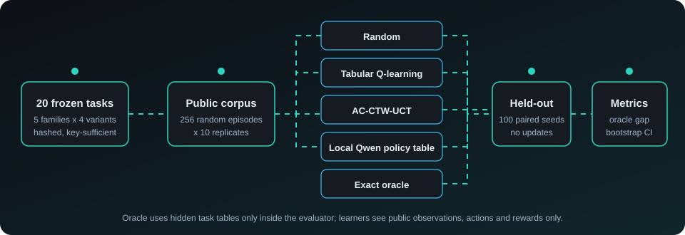
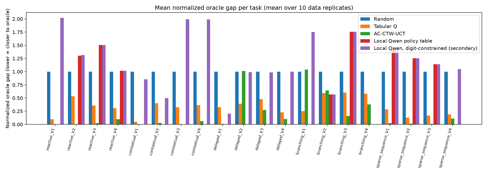

<div align="center">


[](pyproject.toml)
[](tests)
[](https://github.com/ajinkya-awari/aixi-complexity-benchmark/actions/workflows/ci.yml)
[](pyproject.toml)
[](task_specs/frozen_finite_tasks.yaml)
[](#limitations)
[](LICENSE)

</div>



## What this is

A small benchmark that asks how five kinds of decision-making agent compare as declared task-difficulty proxies change:
a random policy, tabular Q-learning, an AC-CTW-UCT planner (inspired by MC-AIXI-CTW, not a faithful reproduction), a
local `Qwen2.5-0.5B-Instruct` policy-table arm, and an exact dynamic-programming oracle. Everything runs locally on CPU.

**Status:** local implementation complete; public release complete with limitations. This is not a claim of scientific
completeness and says nothing about AIXI, AGI or universal intelligence.

## At a glance

| Item | Value |
|---|---|
| Tasks | 20 frozen (5 families x 4 variants), each with 2 actions, 2-8 latent states, 2-4 observations, horizon 8-32 |
| Data | 10 replicates per task, 256 random exploration episodes, 100 held-out episodes (frozen seeds) |
| Primary metric | normalized oracle gap `(V_oracle - V_agent) / max(abs(V_oracle - V_random), 1e-8)`, unclipped |
| Uncertainty | 10,000-resample paired bootstrap per task; hierarchical bootstrap for the suite |
| Verification | 77 tests passing, ruff clean, `aixi-bench verify-run` reports 0 problems |

## Results

Suite level, 95% hierarchical bootstrap intervals. They describe uncertainty for this fixed 20-task suite only, not
inference to all possible tasks.

| Arm | Mean return | Normalized oracle gap | 95% CI |
|---|---:|---:|---|
| Random | 6.17 | 1.000 | [1.000, 1.000] |
| Tabular Q | 10.92 | 0.333 | [0.247, 0.421] |
| AC-CTW-UCT | 12.14 | 0.199 | [0.076, 0.346] |
| Local Qwen policy table | 5.48 | 0.999 | [0.610, 1.351] |
| Exact oracle | 13.16 | 0.000 | [0.000, 0.000] |

Lower gap is closer to the oracle. The Qwen row uses only the 86 of 200 task-replicate records with a valid policy table.



Per-task and per-replicate tables, paired contrasts and the exploratory Holm-corrected Spearman proxy associations are in
[`results/local_run/`](results/local_run) (`summary.csv`, `summary_by_replicate.csv`, `bootstrap_cis.csv`,
`proxy_analysis.csv`).

## How it works

<details open>
<summary><b>Tasks and public interface</b></summary>

Tasks are generated deterministically from one frozen seed, hashed with SHA-256, and stored in
[`task_specs/frozen_finite_tasks.yaml`](task_specs/frozen_finite_tasks.yaml). The public history key (last m
action/observation pairs plus the current observation, m up to 3) is verified to identify the latent state, so every task
is Markov in the key learners see. Difficulty is a six-dimensional proxy vector (reachable history states, order m,
horizon, branching factor, uniform-policy reward density, spec byte length). Proxies are explanatory covariates, not
Kolmogorov complexity, and are never collapsed into one score.
</details>

<details>
<summary><b>Agents</b></summary>

- **Random:** uniform actions with a seeded generator.
- **Tabular Q-learning:** offline on the public corpus; alpha 0.1, gamma 0.99, 20 deterministic shuffled passes, lowest-action tie break.
- **AC-CTW-UCT:** a context tree weighting model with KT estimators at every node predicts (next observation, reward) given the action; 512 UCT simulations, planning horizon min(16, remaining), exploration sqrt(2), seeded tie-breaking. The model is frozen after offline fitting and planning never mutates it.
- **Local Qwen policy table:** pinned model revision, greedy decoding, strict output validation; invalid output is recorded as invalid with no fallback.
- **Exact oracle:** finite-horizon dynamic programming; hidden tables are used only inside the evaluator.
</details>

<details>
<summary><b>Evidence and gates</b></summary>

Gymnasium `check_env` results, task hashes, data manifests and the Qwen license, cache and SHA-256 manifests are under
[`artifacts/`](artifacts). Held-out evaluation is update-free and uses identical seeds for every arm.
</details>

## Reproduce

```bash
python -m venv .venv && .venv/Scripts/pip install -e ".[dev]"   # use .venv/bin on Linux and macOS
aixi-bench tasks validate && aixi-bench env-check && aixi-bench data verify
aixi-bench model-gate        # downloads the pinned Qwen revision (about 1 GB) into the Hugging Face cache
aixi-bench llm-policy        # slow on CPU
aixi-bench run && aixi-bench run --agents local_llm_policy
aixi-bench metrics && aixi-bench bootstrap && aixi-bench proxy-analysis && aixi-bench verify-run
pytest -q && ruff check .
```

The full evaluation is CPU-heavy (AC-CTW-UCT dominates); expect hours on a laptop.

## Repository layout

```text
aixi_bench/      package: tasks, env, analysis (oracle), agents, ctw, accctw, llmpolicy, evalrun, metrics, stats
tests/           77 tests (contracts, environments, oracle, CTW, planner, metrics, packaging)
task_specs/      frozen 20-task corpus
artifacts/       manifests, gate evidence, frozen exploration corpora
results/         local run outputs and figures
draft_outputs/   unreviewed local drafts (not submitted or sent anywhere)
assets/          README diagram
```

## Limitations

- The Qwen arm produced a valid policy table in only 86 of 200 records; 114 are recorded as invalid and excluded from value-based metrics.
- Proxy associations are exploratory; no monotonic relationship between proxies and performance is claimed.
- The suite is small, synthetic and fixed; results do not generalize to other task distributions.
- Python 3.12.13 was used because 3.12.10 was unavailable; other pins are exact (see `pyproject.toml`).
- No remote model or API is used anywhere.

## Attribution

Context Tree Weighting: Willems, Shtarkov and Tjalkens. MC-AIXI-CTW: Veness et al. This project is only inspired by that line of work.

## License

MIT, see [LICENSE](LICENSE).
